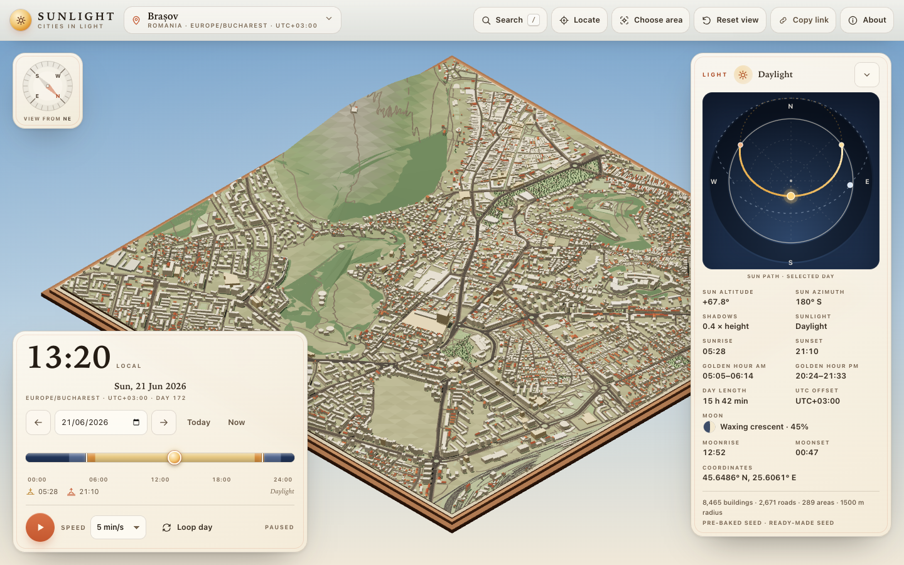
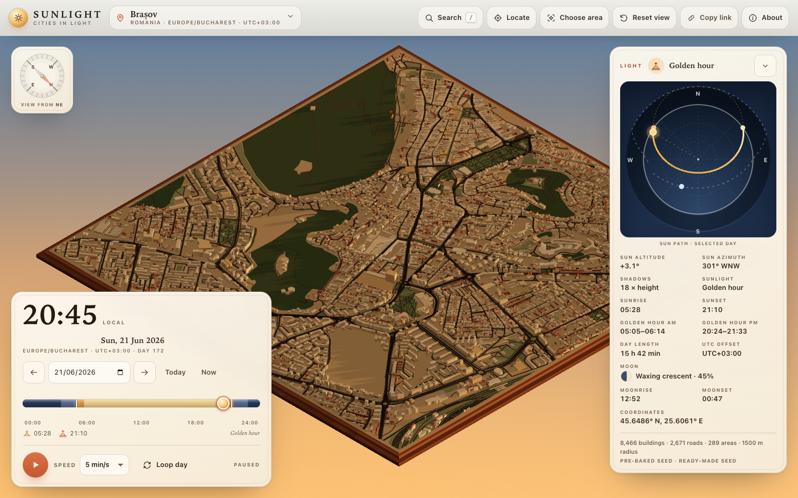
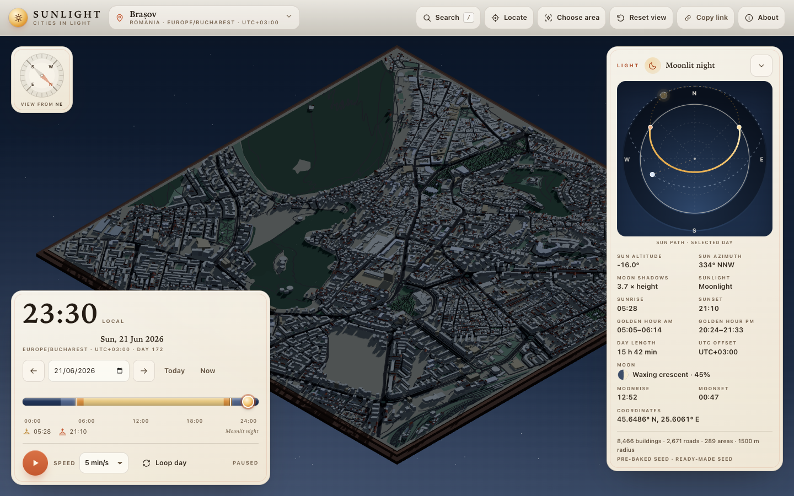
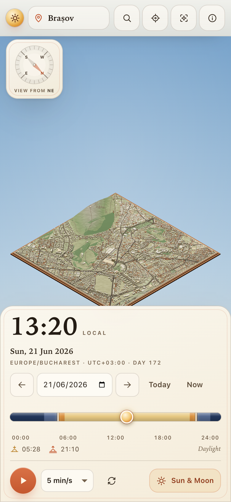
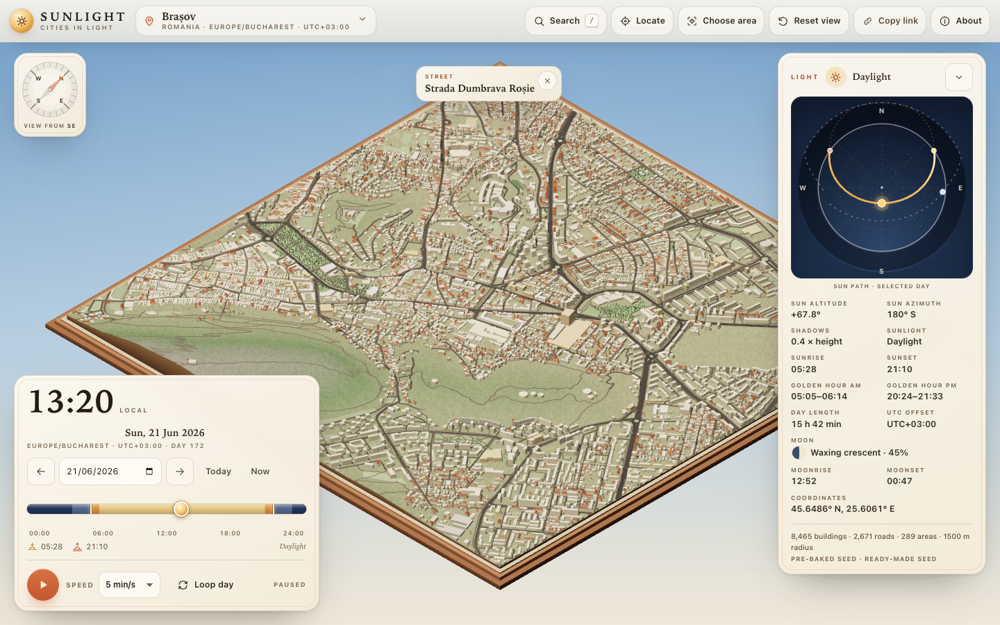

# Sunlight

**A city in light.** Sunlight is a local-first web app that builds a low-poly isometric diorama of a city core and lets you travel through any date between 1900 and 2100, watching real sunlight and moonlight move and cast shadows across the streets.

Pick a city anywhere in the world (or use your current location), drag to explore the model, and scrub the day. The time console shows sunrise, sunset, golden hour, moon phase and the current sun path; the light panel explains exactly where the light is coming from.

## Features

- **Any city** — search a bundled index of ~65,000 populated places, or let the browser locate the nearest one. A custom “my exact location” point is supported too.
- **Explore wider** — each city model covers a 3 km × 3 km core by default, and **Choose area** lets you recenter the diorama on any point you click. Switching cities always starts at that city’s current local date and time.
- **Know the place** — hover or tap named landmarks, streets, parks and waterways for a tooltip with its name, kind and building height. A compact compass rotates with the camera and doubles as a reset-view button.
- **Real geometry** — the server fetches OpenStreetMap building footprints, roads, water, parks and railways, then builds a compact low-poly model of a 3 km × 3 km city core, with names and landmark metadata baked in.
- **Real light** — solar and lunar altitude/azimuth computed with `astronomy-engine`; real-time sun and moon shadows on the model, twilight transitions, moon phase brightness and polar day/night handling.
- **Time travel** — any local date 1900–2100 and minute of day; play/pause at 1×–60× simulated minutes per second, loop a day, or jump to sunrise/sunset/golden hour.
- **Cached once, served forever** — the first visit to a city generates it on the server; the gzipped model is persisted to a disk cache (Docker volume) and served immutably afterwards.
- **Seeded for a fast first run** — eight Romanian cities ship pre-baked: Brașov (default), București, Cluj-Napoca, Timișoara, Iași, Constanța, Sibiu and Oradea.
- **Warm collector’s-diorama design** — crafted plinth, cream placards, terracotta/gold accents, and a sky backdrop that shifts from daylight to golden hour to moonlit night.
- **Works offline for seeded cities** — no API key, no external database.

## Screenshots


*Brașov, 21 June 2026, 13:20 — high summer sun over the old town.*


*The same day at 20:45 — low golden light and 18× long shadows.*


*23:30 — moonlit diorama with a waxing crescent and moon shadows.*


*Phone layout with the collaborative time console and Sun & Moon sheet.*


*Hover or tap a named street or landmark for its placard; the compass in the top-left follows the camera.*

## Quick start

Requirements: Node.js **22.18+** (Node 24 LTS recommended) and npm.

```bash
npm install
npm run dev
```

Open **http://127.0.0.1:5173**. The API runs on port **8090** (Vite proxies `/api` to it). Port 8080 is intentionally not used because Docker Desktop commonly occupies it.

Production mode:

```bash
npm run build
npm start          # http://127.0.0.1:8090
```

Docker:

```bash
docker compose up --build
# open http://127.0.0.1:8090
```

The Compose stack persists generated models in the `sunlight-cache` named volume and runs as a non-root user with a healthcheck. First start is fast because the seed cities are baked into the image.

## Container image (GHCR)

Every push to `master` (and every `v*` tag) builds and publishes a multi-arch
image for `linux/amd64` and `linux/arm64`:

```bash
docker pull ghcr.io/david-batranu/sunlight:latest
```

Tags: `latest` (default branch), `master`, `sha-<commit>`, and version tags.
The image is path-portable: assets are built with a relative base and the SPA
derives its API base from the page URL, so the same image works at `/` or
behind a prefix such as `/sunlight/`.

To run the prebuilt image with the bundled Compose file instead of building
locally:

```bash
export SUNLIGHT_IMAGE=ghcr.io/david-batranu/sunlight:latest
docker compose pull
docker compose up -d --no-build
```

The workflow lives in [`.github/workflows/container.yml`](.github/workflows/container.yml)
and uses the repository `GITHUB_TOKEN` with `packages: write`.

## Subpath deployment (Caddy / Docker network)

Sunlight can be mounted under a path such as `https://seekahead.eu/sunlight/`.
Build with a base path and attach the app to a named Docker network:

```bash
VITE_BASE=/sunlight/ docker compose build
docker compose up -d          # creates the external network `sunlight`
```

Caddy joins that network and strips the prefix:

```caddyfile
seekahead.eu {
    redir /sunlight /sunlight/ 308
    handle_path /sunlight/* {
        reverse_proxy sunlight:8090
    }
    ...
}
```

```yaml
# /srv/caddy/docker-compose.yml
services:
  caddy:
    networks: [..., sunlight]

networks:
  sunlight:
    external: true
    name: sunlight
```

The container port can stay loopback-only (`127.0.0.1:8090:8090`); Caddy reaches
the app over the shared `sunlight` network as `sunlight:8090`. Set
`VITE_BASE` in the deployment `.env` so later `docker compose build` runs keep
the prefix. When running locally, omit it and the SPA stays at `/`.

## How it works

```
Browser SPA (Vite + TypeScript + Three.js)
  search / locate ─► GET /api/cities…
  choose city     ─► POST /api/models → poll /api/jobs/:id → GET /api/models/:key
  change time     ─► GET /api/sky?lat=&lon=&date=
        │
        ▼
Node application server (no database)
  city service: seed → disk cache → job queue → generation worker
  providers: Overpass → official OSM API (adaptive tiles) → seed
  sky service: astronomy-engine day payloads
  cache: gzipped model JSON + metadata on a persistent volume
```

1. The browser resolves a city or point, asks the server for its model and receives either a ready model or a job to poll.
2. On a cache miss, the generation worker fetches OSM data, parses XML/JSON, assembles relations and polygons, projects to local metres, clips/simplifies, infers building heights, and writes a compact gzipped JSON model with an ETag.
3. The browser merges the model into flat-shaded Three.js meshes, builds the plinth, and applies a sun/moon directional light whose direction and colour come from the server’s five-minute ephemeris track.
4. Time changes only re-sample that track — no server round trip per frame — so scrubbing and playback stay smooth.

See [`docs/ARCHITECTURE.md`](docs/ARCHITECTURE.md) for the detailed design and [`docs/CONTRACT.md`](docs/CONTRACT.md) for module interfaces.

## Data sources and attribution

- **City geometry, roads, water, parks**: © OpenStreetMap contributors, available under the [Open Database License (ODbL 1.0)](https://www.openstreetmap.org/copyright). Geometry is fetched from Overpass or the official OSM API and cached locally. The app displays attribution in the About dialog and footer.
- **City search index**: [GeoNames](https://www.geonames.org/) `cities5000`, licensed CC BY 4.0.
- **Sun/moon positions**: [`astronomy-engine`](https://github.com/cosinekitty/astronomy) (MIT).
- **3D rendering**: [Three.js](https://threejs.org/) (MIT).

No API keys are required. For a high-traffic public deployment, OSM’s public infrastructure is not an appropriate data source — add a commercial provider behind the existing provider interface (Mapbox/Overture) and keep the cache. Low-volume, cache-first personal or team use is the intended mode.

## Configuration

Copy `.env.example` to `.env` or pass environment variables. Everything is optional.

| Variable | Default | Description |
|---|---|---|
| `PORT` | `8090` | HTTP port |
| `HOST` | `127.0.0.1` (compose: `0.0.0.0`) | Listen address |
| `CACHE_DIR` | `.cache/sunlight` | Model/raw-tile cache directory |
| `CACHE_MAX_MB` | `1024` | LRU cache size limit |
| `CITY_RADIUS_M` | `1500` | Half-size of the generated city core (600–1500) |
| `GENERATION_CONCURRENCY` | `1` | Parallel generation workers |
| `CITY_SOURCE` | `auto` | `auto`, `overpass`, `osm-api`, `fixture`, or `seed` |
| `SEEDS_ONLY` | `0` | Refuse network generation; serve seeds/cache only |
| `DEFAULT_CITY` | `gn-683844` | Default GeoNames city id (Brașov) |
| `OSM_USER_AGENT` | dev UA | **Set a real contact URL before deploying** |
| `OVERPASS_ENDPOINTS` | overpass-api.de | Comma-separated Overpass endpoints |
| `RATE_LIMIT_PER_MIN` | `30` | Per-IP model-generation requests; `0` disables |

## Scripts

| Command | Purpose |
|---|---|
| `npm run dev` | API (watch) + Vite dev server |
| `npm run build` | Typecheck, bundle server/worker, build SPA |
| `npm start` | Serve built SPA + API |
| `npm run typecheck` | TypeScript checks for web and server |
| `npm test` | Unit + integration tests (offline fixtures) |
| `npm run test:unit` | Unit tests only |
| `npm run test:e2e` | Build + seed-only server + Playwright browser tests/screenshots |
| `npm run build:index` | Rebuild the bundled GeoNames city search index |
| `npm run bake:seeds` | Regenerate the eight pre-baked Romanian city models (network) |
| `npm run cache:clear` | Delete the local model cache |

## Caching

- Models are cached under `CACHE_DIR/models/<key>.json.gz` with a sidecar metadata file; writes are atomic.
- Responses carry strong ETags and are immutable per model version; repeat visits are served from disk and revalidate with `304`.
- Provider responses are not persisted between attempts in v1; a failed generation is retried from scratch or falls back to a bundled seed where available.
- The cache key includes the model version and radius. Bump `MODEL_VERSION` in `shared/constants.ts` and run `npm run cache:clear` when changing the model format.
- Seeds live in `server/data/seeds/` with a SHA-256 manifest and are read-only at runtime.
- In Docker, the `sunlight-cache` volume survives container restarts and rebuilds.

## Tests

```bash
npm run typecheck
npm test                 # node --test unit + integration, no network
npm run test:e2e         # Playwright-core with system Chrome, seed city only
```

The E2E runner blocks external network access in the browser, uses an isolated temporary cache and starts the server on a free port. Screenshots land in `qa/shots/`. If Chrome is not at the default macOS location, set `CHROME_PATH`. The latest browser QA report is in [`qa/report.md`](qa/report.md) (23/23 E2E checks green; unit + integration suite 302 tests).

## Project layout

```text
src/            SPA: app state/api/url/time, Three.js scene, DOM UI, styles
server/         Node app: HTTP/API, city generation + cache/jobs, sky ephemeris
shared/         Types/constants shared by browser, server and tests
scripts/        Dev runner, build, seed bake, city index, E2E runner
server/data/    Generated GeoNames index + pre-baked seed models
tests/          Unit, integration and browser E2E tests
docs/           Architecture and implementation contract
qa/             Screenshots and QA notes
```

## Known limitations

- Flat city core: no terrain, hills or bridges; a diorama, not a survey model.
- On narrow portrait screens the diorama deliberately fits the full base, so some sky remains above/below; a portrait-specific camera framing is a follow-up.
- 3 km core per city by default; surrounding districts are not included. Use **Choose area** to recenter the model on a different part of the city.
- Height tags are sparse in OSM, so most buildings receive an inferred height (local median + building type + deterministic variation), not a surveyed one.
- Clear-sky lighting only: no weather or clouds.
- Dates are limited to 1900–2100. Timezone/DST data outside the modern tzdb era is best-effort.
- First generation of a new city needs network access to OSM; seeded and cached cities do not.
- Generation is single-instance: the job queue is in memory. Parallel server replicas would need a shared queue/lock.
- Public high-traffic deployments should use a commercial map data provider rather than OSM’s public endpoints.

## Troubleshooting

- **A new city generation hangs or fails** — public Overpass instances are sometimes saturated; the server automatically falls back to the official OSM API. Try again later, choose a seed city, or set `CITY_SOURCE=osm-api`.
- **Port already in use** — set `PORT` and update `vite.config.ts`’s proxy target if you change the API port for development.
- **No shadows / blank canvas** — Sunlight needs WebGL2. Check the browser console; the app shows a fallback message when WebGL is unavailable.
- **Docker volume permissions** — the image creates `/data/cache` owned by the `node` user; avoid mounting a host directory without matching ownership.

## License

Application code © the project authors. Map data © OpenStreetMap contributors (ODbL 1.0); GeoNames data CC BY 4.0. See the About dialog in the app for live attribution.
